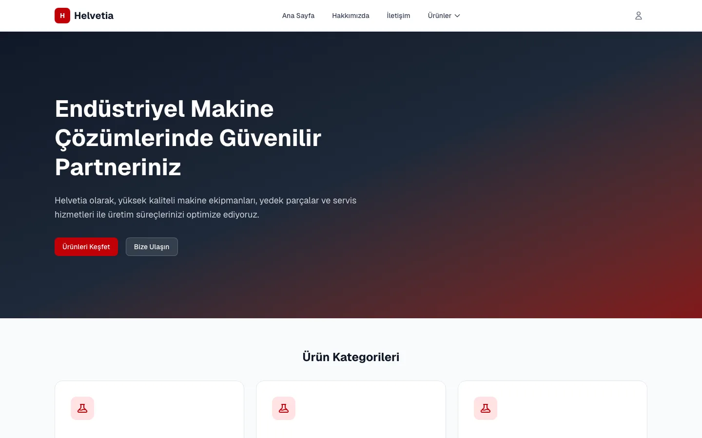

# Helvetia Machine

Full-stack product catalogue for machinery, spare parts and service – an ASP.NET Core Web API with a
Next.js front end and an admin area for managing categories, subcategories and image galleries.
Demo project, Turkish-language UI.



## Features

- Public catalogue: categories → subcategories → image galleries (title and description per image)
- Admin area with login: create, edit and delete categories and subcategories
- Several images per subcategory – upload, caption, remove
- Uploads of images and PDFs up to 10 MB, stored in Cloudinary or on the server volume
- Files are removed from storage when their entry is deleted or the image is replaced

## Stack

| Part | Technology |
|---|---|
| API | ASP.NET Core 9, Entity Framework Core, PostgreSQL (Npgsql), JWT bearer auth, BCrypt |
| Front end | Next.js 16 (App Router), React 19, TypeScript, Tailwind CSS 4 |
| Media | Cloudinary (optional) or local `wwwroot/uploads` |
| Deploy | Docker (multi-stage), Render blueprint (`render.yaml`) |

```
backend/HelvetiaApi/   REST API (Controllers, Services, Data, Models, DTOs)
frontend/              Next.js app (src/app, src/components, src/lib)
docker-compose.yml     local PostgreSQL
render.yaml            Render blueprint for the API
```

## Security

- Every write endpoint requires the `Admin` role.
- No credentials in the repository: the JWT signing key and the admin account come only from
  environment variables (`Jwt__Key`, `Admin__Username`, `Admin__Password`). The API refuses to start
  without them (key ≥ 32 characters, password ≥ 12 characters).
- The admin account is reconciled on every start: changing `Admin__Password` rotates the password with
  the next deploy, and accounts with any other username are removed (the app has exactly one admin).

## Local development

Requirements: .NET 9 SDK, Node.js 20+, Docker.

```bash
# 1. Database (PostgreSQL on localhost:5433)
docker compose up -d

# 2. API on http://localhost:5001
cd backend/HelvetiaApi
export ASPNETCORE_ENVIRONMENT=Docker          # uses appsettings.Docker.json → the compose database
export Jwt__Key="$(openssl rand -base64 48)"
export Admin__Username=admin
export Admin__Password='choose-a-long-password'
dotnet run --no-launch-profile --urls http://localhost:5001

# 3. Front end on http://localhost:3000
cd ../../frontend
npm ci
NEXT_PUBLIC_API_URL=http://localhost:5001/api npm run dev
```

On first start the API creates the schema and seeds three categories with sample subcategories.
The admin panel is at `/admin/login`.

## Environment variables (API)

| Variable | Required | Purpose |
|---|---|---|
| `Jwt__Key` | yes | JWT signing key, at least 32 characters |
| `Admin__Username`, `Admin__Password` | yes | The single admin account |
| `DATABASE_URL` or `ConnectionStrings__DefaultConnection` | yes | PostgreSQL (`postgres://…` URLs are supported) |
| `FRONTEND_URL`, `CORS_ALLOWED_ORIGINS` | no | Additional CORS origins |
| `CLOUDINARY_CLOUD_NAME`, `CLOUDINARY_API_KEY`, `CLOUDINARY_API_SECRET` | no | Store uploads in Cloudinary instead of the local volume |

Set secrets in the Render dashboard; `render.yaml` lists them with `sync: false`.
